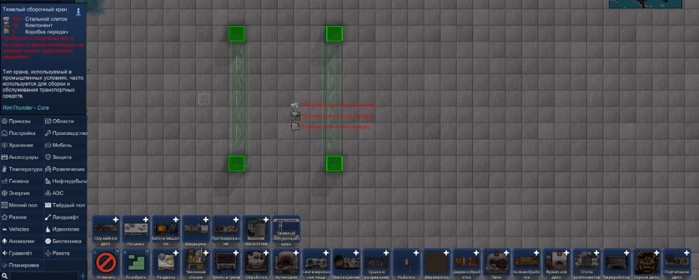

# HSK-RimThunder

[Русский](#hsk-rimthunder-ru) | [English](#hsk-rimthunder-en)

---

# HSK-RimThunder (RU)

Глобальная адаптация и интеграция линейки военной техники **RimThunder** для сборки **Hardcore-SK (HSK)** под **RimWorld 1.6**.

Мод объединяет 11 взаимосвязанных паков RimThunder с экосистемой **Vehicle Framework**, **Combat Extended**, **Vanilla Vehicles Expanded**, **Vehicles CE Overhaul (VCEO)** и **HSK Vehicles Bridge (HSKV)**. В игру вводится более **35 полностью настроенных видов боевой, транспортной и разведывательной техники**: от армейских мотоциклов, бронеавтомобилей и танков времён Второй мировой войны до современных БМП, вертолётов и платформ следующего поколения (Т-14 «Армата», Abrams SEP, Т-90М «Прорыв», Bradley, БМП-3, БМПТ «Терминатор»).

> **⚠️ Обратите внимание:** вся техника собирается на отдельном специализированном станке — **Тяжёлый сборочный кран** (`RT_AssemblyCrane`). Для его размещения требуются **4 опорные стены**, установленные с расстоянием **6×8 клеток** (как показано на скриншоте выше).

---

### 🛠 Состав сборки (11 модулей RimThunder)

- **RimThunder - Core** — базовое ядро, сборочный кран `RT_AssemblyCrane`, приставки-накопители, общая библиотека калибров и рецептов CE, объединённый пресет рейдов.
- **RimThunder - Breakthrough** — БМП-3, БМПТ «Терминатор», основной боевой танк Т-80БВМ.
- **RimThunder - Desert Sabre** — M1A2 SEP Abrams, лёгкий танк поддержки M10 Booker, БМП M2A3 Bradley.
- **RimThunder - Enduring Freedom** — бронеавтомобиль Oshkosh M-ATV, армейский грузовик M1078 LMTV.
- **RimThunder - Flying Chariot** — тяжёлый транспортный самолёт C-130 Hercules, вертолёты CH-53E Super Stallion и UH-60 Black Hawk.
- **RimThunder - Kon'** — полноприводный грузовик КамАЗ-5350, бронеавтомобиль «Тайфун-ВДВ».
- **RimThunder - Roaring Tiger** — танки M1A2 Abrams и M48H Brave Tiger, бронетранспортёры M113 и M113(M) с миномётом, тяжёлый тягач M1075 HEMTT.
- **RimThunder - Talvisota** — танки Т-34 обр. 1941 г., Т-28, лёгкий танк БТ-5, армейский мотоцикл М-72, бронированные аэросани РФ-8 (ГАЗ-98).
- **RimThunder - Time Forward** — танк нового поколения Т-14 «Армата» (125-мм / 152-мм) и тяжёлая гусеничная БМП Т-15 «Армата».
- **RimThunder - Way to Victory** — тяжёлые танки прорыва ИС-2 и ИС-3, лёгкий танк Т-70, Т-34-85, реактивная система залпового огня БМ-13 «Катюша», бронеавтомобиль БА-64.
- **RimThunder - Zarya** — танк Т-90М «Прорыв-3», гусеничная БМП «Курганец-25», колёсная БМП «Бумеранг».

---

### 🌟 Ключевые особенности адаптации

1. **Экономика модулей HSK Vehicles Bridge (`HSKV_Parts`):**
   - Все 35 чертежей техники (`VehicleBuildDef`), 31 сборочный рецепт на кране и 45 узлов древ модернизации переведены на модули HSKV: двигатели (`HSKV_Engine_*`), трансмиссии VVE, лёгкая и тяжёлая броня (`HSKV_Armor_Light`/`Heavy`), СУО (`HSKV_FireControl`), бортовая электроника, продвинутые блоки управления и аутентичные сплавы HSK.
   - Исключены несуществующие детали, сырые слитки и устаревшие компоненты.

2. **Бесшовная интеграция с исследованиями HSK, VVE и Core_SK:**
   - Все устаревшие изолированные ветки `RT_*` удалены.
   - Чертежи и все 45 узлов деревьев улучшений привязаны к существующим исследованиям автотранспорта, бронетехники и сплавов HSKV и Core_SK.
   - **Честный технологический уровень:** вся техника (включая Т-14 и Т-15) находится на уровне `Industrial` — никаких техпринтов и принудительного `Spacer` techLevel.

3. **Стрельба и баллистика Combat Extended через VCEO:**
   - Стрельба турелей, перезарядка, оптика и баллистика напрямую переданы движку **Vehicles CE Overhaul (VCEO)**.
   - Добавлены расширения прицеливания `TurretAimExtension` для всех 82 активных боевых турелей (учёт навыков наводчика, дистанции, погодных условий, дымовых завес и упреждения целей).
   - Честная механика навесного огня: миномёты калибров 81 мм и 107 мм, а также РСЗО БМ-13 «Катюша» (132-мм ракеты М-13 с правильным веером рассеивания).
   - Разделение калибров: введён калибр `AmmoSet_30x165mm` для советских и российских 30-мм автоматических пушек (2А42, 2А72), турели НАТО адаптированы под `25x137mm NATO` и `30x113mmB`.

4. **Профили бронирования `<scale>HSK</scale>`:**
   - Для всех 35 машин созданы собственные `VehicleArmorDef` с тегом `<scale>HSK</scale>`, откалиброванные в единицах HSK (мм sharp / МПа blunt) для лобовой, бортовой, кормовой и верхней проекций, а также башен, юбок и блоков динамической защиты.
   - Исправлены хитбоксы экипажа и десанта, узлы внешней ходовой части корректно выведены наружу (`External`).

5. **Трёхуровневая система активной защиты (КАЗ):**
   - **Tier 1.5 (Пред-Spacer КАЗ):** Т-14 «Армата» (14 зарядов, залп по 2) и Т-15 (12 зарядов, залп по 2) с повышенным сектором и радиусом перехвата снарядов и ПТУР.
   - **Tier 2 (Штатный армейский КАЗ):** Т-90М «Прорыв» (6 зарядов), «Курганец-25» (4 заряда) и «Бумеранг» (4 заряда).
   - **Tier 3 (Блокировка авто-КАЗ):** на остальных машинах установлены заглушки `maxCharges = 0`, исключающие случайную раздачу КАЗ старой или лёгкой технике со стороны VCEO.

6. **Единый сбалансированный пресет рейдов (`HSKV_RimThunder_Unified_Preset`):**
   - Объединяет всю технику HSKV (VVE + 40k) и все 35 машин RimThunder в единую систему рейдов VRF.
   - Точный баланс по формуле HSKV: `minRaidPoints = round(combatPower * 4.285714)` и `VehiclePointsFraction: 0.5`. Техника не съедает 100% бюджета рейда, налётчики всегда сопровождаются достаточным пехотным прикрытием.
   - Логичное распределение по 25 технологическим фракциям: пираты и бандиты используют лёгкую технику и трофейную броню ВМВ, поселенцы — транспорт и лёгкие танки, а развитые империи и корпорации — современные БМП, вертолёты и ОБТ.

---

### 📥 Порядок загрузки модов

1. `Harmony` (`brrainz.harmony`)
2. `Core` (RimWorld 1.6)
3. `Vehicle Framework` (`SmashPhil.VehicleFramework`)
4. `Vanilla Expanded Framework` (`OskarPotocki.VanillaFactionsExpanded.Core`)
5. `Vanilla Vehicles Expanded` (`OskarPotocki.VanillaVehiclesExpanded`)
6. `Combat Extended` (`CETeam.CombatExtended`)
7. `Core_SK` (`skyarkhangel.HSK`)
8. `Vehicles CE Overhaul` (`blakil.vehiclesceoverhaul`)
9. `HSK Vehicles Bridge` (`blakil.hsk.vehiclesbridge`)
10. *(Опционально)* `VehicleRaid Framework` (`gabrieel1482.raidvehicleframework`)
11. `RimThunder - Core` (`RimThunder.Core`)
12. `[Остальные 10 модулей RimThunder в любом порядке]`

---

### ⚙️ Выбор пресета рейдов в игре
Если вы используете **VehicleRaid Framework**:
**Настройки (Settings) → Настройки модов (Mod Options) → Vehicle Raid Framework → Presets** → выберите **`HSKV_RimThunder_Unified_Preset`** и нажмите **Apply**.

---

# HSK-RimThunder (EN)

A comprehensive adaptation and integration of the **RimThunder** military vehicle series for the **Hardcore-SK (HSK)** modpack for **RimWorld 1.6**.

This pack integrates 11 interconnected RimThunder modules with the **Vehicle Framework**, **Combat Extended**, **Vanilla Vehicles Expanded**, **Vehicles CE Overhaul (VCEO)**, and **HSK Vehicles Bridge (HSKV)** ecosystems. It introduces over **35 fully customized combat, transport, and reconnaissance vehicles**: from army motorcycles, aerosanis, and WWII armor to modern IFVs, utility/cargo helicopters, and next-generation platforms (T-14 "Armata", Abrams SEP, T-90M "Proryv", Bradley, BMP-3, BMPT "Terminator").

> **⚠️ Please note:** All vehicles are assembled at a dedicated industrial workstation — the **Heavy Assembly Gantry** (`RT_AssemblyCrane`). Placing it requires **4 pillar walls** constructed with an internal spacing of **6×8 cells** (as shown in the screenshot above).

---

### 🛠 Mod Pack Contents (11 RimThunder Packs)

- **RimThunder - Core** — base core, `RT_AssemblyCrane` gantry, storage attachments, unified CE caliber & recipe library, unified raid preset.
- **RimThunder - Breakthrough** — BMP-3, BMPT "Terminator", T-80BVM main battle tank.
- **RimThunder - Desert Sabre** — M1A2 SEP Abrams, M10 Booker fire support tank, M2A3 Bradley IFV.
- **RimThunder - Enduring Freedom** — Oshkosh M-ATV MRAP, M1078 LMTV military truck.
- **RimThunder - Flying Chariot** — C-130 Hercules transport aircraft, CH-53E Super Stallion and UH-60 Black Hawk helicopters.
- **RimThunder - Kon'** — KamAZ-5350 6x6 army truck, Typhoon-VDV armored vehicle.
- **RimThunder - Roaring Tiger** — M1A2 Abrams and M48H Brave Tiger tanks, M113 APC and M113(M) mortar carrier, M1075 HEMTT heavy tractor.
- **RimThunder - Talvisota** — T-34 mod. 1941, T-28, BT-5 light tank, M-72 military motorcycle, RF-8 (GAZ-98) armored aerosani.
- **RimThunder - Time Forward** — next-generation T-14 "Armata" MBT (125mm / 152mm) and T-15 heavy tracked IFV.
- **RimThunder - Way to Victory** — IS-2 and IS-3 heavy tanks, T-70 light tank, T-34-85, BM-13 "Katyusha" MLRS, BA-64 scout armored car.
- **RimThunder - Zarya** — T-90M "Proryv-3" MBT, "Kurganets-25" tracked IFV, "Boomerang" wheeled IFV.

---

### 🌟 Key Features of the Adaptation

1. **HSK Vehicles Bridge Component Economy (`HSKV_Parts`):**
   - All 35 vehicle blueprints (`VehicleBuildDef`), 31 crane assembly recipes, and 45 upgrade nodes have been migrated to HSKV modular parts: engines (`HSKV_Engine_*`), VVE transmissions, light and heavy armor plates (`HSKV_Armor_Light`/`Heavy`), fire control systems (`HSKV_FireControl`), onboard electronics, advanced control units, and authentic HSK alloys.
   - Obsolete engine parts, raw ingot costs, and unsupported materials have been completely removed.

2. **Native Research Integration with HSK, VVE & Core_SK:**
   - Legacy custom `RT_*` research trees have been cleanly removed.
   - Blueprints and all 45 upgrade tree nodes are logically linked to standard HSKV and Core_SK automotive and armored vehicle technologies.
   - **Authentic Tech Level:** All vehicles (including T-14 and T-15) remain strictly at `Industrial` tech level — no techprints or forced Spacer prerequisites.

3. **Combat Extended Ballistics via VCEO:**
   - Full delegation of turret shooting, reloading, optics, and ballistics directly to **Vehicles CE Overhaul (VCEO)**.
   - Added `TurretAimExtension` aiming parameters to all 82 active combat turrets (accounting for gunner skill, target range, weather, smoke concealment, and target leading).
   - Authentic indirect fire: 81mm and 107mm mortars, plus the BM-13 "Katyusha" MLRS (132mm M-13 rockets with authentic trajectory and realistic circular dispersion).
   - Caliber split: Introduced `AmmoSet_30x165mm` for Soviet and Russian 30mm autocannons (2A42, 2A72); NATO autocannons use `25x137mm NATO` and `30x113mmB`.

4. **Calibrated `<scale>HSK</scale>` Armor Profiles:**
   - All 35 vehicles feature dedicated `VehicleArmorDef` profiles with `<scale>HSK</scale>`, calibrated in true HSK units (mm sharp / MPa blunt) across front, side, rear, and roof hulls, as well as turrets, skirts, and ERA plates.
   - Crew and passenger hitboxes properly configured; external running gear correctly assigned as `External`.

5. **Three-Tier Active Protection Systems (APS):**
   - **Tier 1.5 (Pre-Spacer APS):** T-14 "Armata" (14 charges, 2-burst salvo) and T-15 (12 charges, 2-burst salvo) with expanded radius and high interception reliability against incoming missiles and shells.
   - **Tier 2 (Standard Military APS):** T-90M "Proryv" (6 charges), Kurganets-25 (4 charges), and Boomerang (4 charges).
   - **Tier 3 (Zero-Charge Override):** All other vehicles have `maxCharges = 0` to prevent unintended auto-APS assignment by VCEO.

6. **Unified Raid Preset (`HSKV_RimThunder_Unified_Preset`):**
   - Combines all HSKV vehicles (VVE + 40k) and all 35 RimThunder vehicles into a unified, balanced VRF raid preset.
   - Balanced strictly according to the HSKV formula: `minRaidPoints = round(combatPower * 4.285714)` and `VehiclePointsFraction: 0.5`. Vehicles never monopolize the raid point budget; raids always arrive with an appropriate infantry escort.
   - Cleanly assigned across 25 technological factions: raiders and pirates field light logistics and WWII armor, outlanders deploy transports and medium armor, while advanced factions bring modern IFVs, aviation, and MBTs.

---

### 📥 Recommended Load Order

1. `Harmony` (`brrainz.harmony`)
2. `Core` (RimWorld 1.6)
3. `Vehicle Framework` (`SmashPhil.VehicleFramework`)
4. `Vanilla Expanded Framework` (`OskarPotocki.VanillaFactionsExpanded.Core`)
5. `Vanilla Vehicles Expanded` (`OskarPotocki.VanillaVehiclesExpanded`)
6. `Combat Extended` (`CETeam.CombatExtended`)
7. `Core_SK` (`skyarkhangel.HSK`)
8. `Vehicles CE Overhaul` (`blakil.vehiclesceoverhaul`)
9. `HSK Vehicles Bridge` (`blakil.hsk.vehiclesbridge`)
10. *(Optional)* `VehicleRaid Framework` (`gabrieel1482.raidvehicleframework`)
11. `RimThunder - Core` (`RimThunder.Core`)
12. `[Remaining 10 RimThunder modules in any order]`

---

### ⚙️ How to Select the Raid Preset In-Game
If using **VehicleRaid Framework**:
**Settings → Mod Options → Vehicle Raid Framework → Presets** → select **`HSKV_RimThunder_Unified_Preset`** and click **Apply**.

---

### 👥 Credits & Acknowledgements

- **RimThunder Team** (AOBA, Cannon Mutton, RimThunderTeams) — [RimThunder Workshop Collection](https://steamcommunity.com/workshop/filedetails/?id=3276606914)
- **Blakil** — [Vehicles CE Overhaul](https://steamcommunity.com/sharedfiles/filedetails/?id=3836521434) & HSK Vehicles Bridge
- **SmashPhil** — [Vehicle Framework](https://steamcommunity.com/sharedfiles/filedetails/?id=3014915404)
- **Oskar Potocki & Vanilla Expanded Team** — [Vanilla Expanded Framework](https://steamcommunity.com/sharedfiles/filedetails/?id=2023507013) & Vanilla Vehicles Expanded
- **Combat Extended Team** — [Combat Extended](https://github.com/CombatExtended-Continued/CombatExtended)
- **Hardcore-SK Community & Developers**
